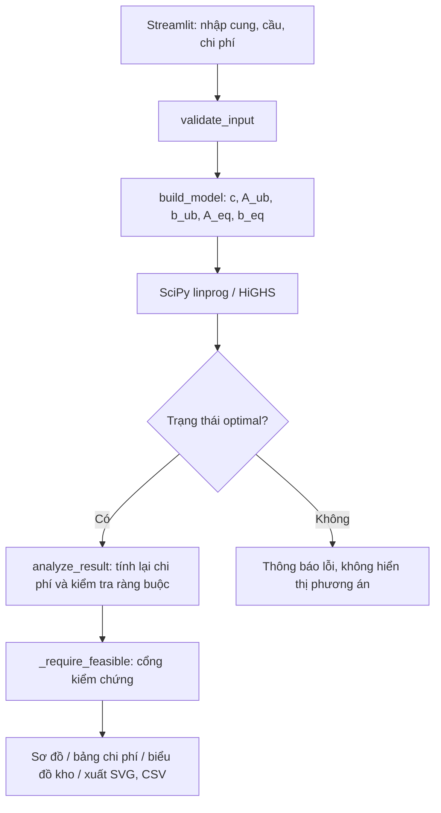

# Demo TransportOpt cho phần 4 của proposal_final

Đối chiếu với `docs/proposal/proposal_final.md`, các mục 4.1–4.15 trong
nội dung chính (mục lục của proposal hiện đánh số khác nội dung chính).

## Chạy và trình bày trong khoảng 5 phút

```bash
uv sync --group dev
uv run streamlit run app.py
```

1. Chọn `2 × 3 example` ở sidebar, bấm **Nạp ví dụ**. Giới thiệu cung 150,
   cầu 150; mỗi hàng chi phí tương ứng một kho, mỗi cột là một khách hàng.
2. Ở **Bước 2**, dùng sơ đồ để giải thích các tuyến có thể vận chuyển.
   `c` là chi phí/đơn vị. Chọn một khách hàng để theo dõi các kho có thể cấp hàng.
3. Mở **Xem cách tạo vector và ma trận thực tế**: chỉ ra thứ tự biến theo hàng,
   vector `c`, ràng buộc cung `A_ub x ≤ b_ub` và cầu `A_eq x = b_eq`.
4. Bấm **Tìm phương án tối ưu**. Kết quả 2×3 là **620**.
   Trong sơ đồ kết quả, `x` là lượng hàng thực giao; tuyến không dùng được bỏ khỏi hình.
5. Mở tab **Phân bổ và chi phí**: đọc ma trận lượng giao và phép tính
   `50 × 4 + 30 × 6 + 30 × 4 + 40 × 3 = 620`.
6. Mở tab **Kiểm chứng nghiệm**: đối chiếu đã giao/còn lại theo kho,
   đã nhận/cầu theo khách hàng và vi phạm lớn nhất không vượt `1e-8`.
7. Chuyển sang `3 × 5 example`, bấm **Nạp ví dụ**, rồi giải. Kết quả **696**
   để đối chiếu case study ở Mục 2.10. Có thể tải sơ đồ SVG và phương án CSV.
8. Demo thay đổi dữ liệu: tăng cung một kho để thấy hàng dư được giữ lại;
   giảm tổng cung xuống dưới tổng cầu để thấy cảnh báo và kết quả cũ bị xoá.
   Nạp lại ví dụ để khôi phục dữ liệu trước khi chụp hình.

Dữ liệu đầu vào thay đổi sẽ xoá kết quả cũ. Đổi tab hoặc bộ lọc sơ đồ vẫn giữ
kết quả của cùng bộ dữ liệu. Khi cập nhật source trên một server đang chạy,
nên khởi động lại Streamlit để tải lại các module Python đã import.

## Hình dùng cho báo cáo

Các hình dưới được chụp từ trình duyệt trên case 3×5, ngày 31/10/2026:

| Hình | Nội dung | Mục phù hợp trong proposal |
| --- | --- | --- |
| [Mạng vận chuyển](3x5-network.png) | Cung/cầu, lượng hàng và chi phí trên tuyến tối ưu | 4.5, 4.7, 4.13 |
| [Phân bổ và chi phí](3x5-costs.png) | Ma trận X, từng tích lượng × giá và tổng 696 | 4.5, 4.7, 4.13 |
| [Kiểm chứng nghiệm](3x5-checks.png) | Cung, cầu, sử dụng kho và sai số | 4.10, 4.14 |

Có thể dùng mô tả sau cho phần giao diện/quy trình:

> TransportOpt tổ chức tương tác thành bốn bước: nhập dữ liệu, mô hình hóa,
> giải bài toán và kiểm chứng phương án. Mạng hai phía biểu diễn các kho và
> khách hàng; trước tối ưu, cạnh thể hiện chi phí đơn vị, còn sau tối ưu chỉ
> giữ các tuyến có lượng giao dương. Bảng ánh xạ biến và các ma trận ràng buộc
> giúp liên hệ dữ liệu thực tế với dạng LP. Kết quả được trình bày đồng thời
> bằng sơ đồ, ma trận lượng giao, bảng chi phí từng tuyến và biểu đồ sử dụng
> kho. Ứng dụng tính lại tổng chi phí và kiểm tra các ràng buộc trước khi
> hiển thị nghiệm, với ngưỡng sai số khả thi 10⁻⁸.

## Kiến trúc thực tế (Mục 4.6 và 4.9)



## Bằng chứng và giới hạn báo cáo

Kiểm tra sau thay đổi:

```bash
uv run pytest -q
uv run ruff check .
uv run ruff format --check .
```

- Bộ test: **51 passed**, bao gồm UI AppTest cho 620/696, giữ nghiệm khi lọc,
  xoá nghiệm khi đổi dữ liệu, dư cung, cầu bằng 0 và dữ liệu không hợp lệ.
- Kiểm tra trình duyệt: giải 2×3 được 620; chuyển sang 3×5 được 696 sau khi
  sửa đồng bộ số kho/khách hàng khi nạp ví dụ; các tab kết quả render được,
  case 3×5 có vi phạm lớn nhất 0.00e+00.
- Đây là diễn giải **lập mô hình và kiểm chứng nghiệm**, không phải triển khai
  giải tay hay xuất từng vòng lặp Simplex/MODI. HiGHS được gọi bằng `method='highs'`;
  ứng dụng không khẳng định phương pháp nội bộ cụ thể cho mỗi lần giải.
- Sơ đồ là mạng phân bổ hàng, không có tọa độ địa lý hay lộ trình xe. Với nhiều
  tuyến, nên lọc từng khách hàng để dễ đọc. Tên quá dài có thể vượt khung nút.
- Kiểm tra khả thi không tự chứng minh tối ưu; kết luận tối ưu dựa trên trạng thái
  solver. Nếu có nhiều nghiệm tối ưu, cách phân bổ có thể khác nhưng cùng chi phí.
- Các hình demo không phải bằng chứng runtime, memory hoặc saving ratio.
  Thực nghiệm quy mô lớn của Mục 4.12 vẫn dùng `scripts/run_experiments.py`;
  lần nâng cấp giao diện này không chạy lại benchmark.
