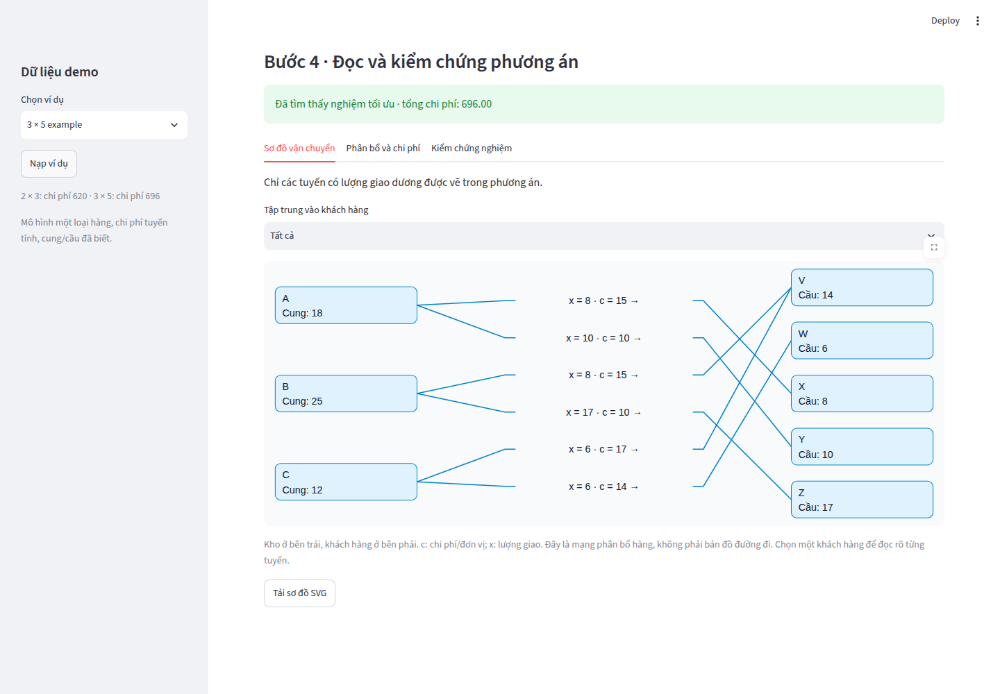
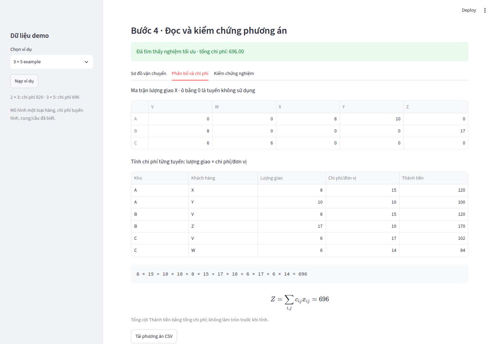
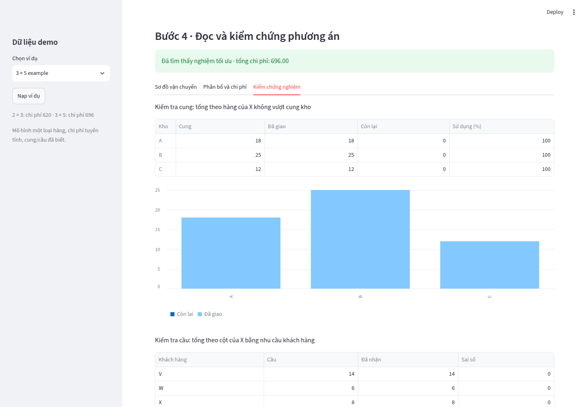

# ĐỀ XUẤT ĐỀ TÀI

## ỨNG DỤNG QUY HOẠCH TUYẾN TÍNH TRONG TỐI ƯU HÓA BÀI TOÁN VẬN TẢI

---

# MỤC LỤC

**1. PHẦN MỞ ĐẦU**
1.1. Lý do chọn đề tài
1.2. Bối cảnh bài toán
1.3. Mục tiêu đề tài
1.4. Đối tượng và phạm vi nghiên cứu
1.5. Phương pháp nghiên cứu
1.6. Kết quả dự kiến

**2. CÁC KHÁI NIỆM VÀ BÀI TOÁN THỰC TẾ VỀ QUY HOẠCH TUYẾN TÍNH**
2.1. Khái niệm tối ưu hóa
2.2. Quy hoạch tuyến tính
2.3. Các thành phần của mô hình quy hoạch tuyến tính
2.4. Biểu diễn bằng đại số tuyến tính
2.5. Miền nghiệm khả thi và nghiệm tối ưu
2.6. Một số bài toán thực tế
2.7. Bài toán vận tải
2.8. Mối liên hệ giữa bài toán vận tải và bài toán luồng trên mạng
2.9. Các phương pháp lập nghiệm ban đầu cho bài toán vận tải
2.10. Case study xuyên suốt 3 kho và 5 khách hàng

**3. CƠ SỞ LÝ THUYẾT VÀ THUẬT TOÁN TÌM PHƯƠNG ÁN TỐI ƯU TUYẾN TÍNH**
3.1. Dạng chuẩn của bài toán quy hoạch tuyến tính
3.2. Cơ sở đại số tuyến tính
3.3. Nghiệm cơ sở và nghiệm cơ sở khả thi
3.4. Ý tưởng hình học của phương pháp Simplex
3.5. Thuật toán Simplex
3.6. Bài toán đối ngẫu
3.7. Phương pháp điểm trong
3.8. Bài toán vận tải và cấu trúc ma trận đặc biệt
3.9. Phương pháp giải tay và lựa chọn thuật toán

**4. SẢN PHẨM PHẦN MỀM TÌM PHƯƠNG ÁN TỐI ƯU CHO BÀI TOÁN VẬN TẢI**
4.1. Tên sản phẩm
4.2. Mục tiêu sản phẩm
4.3. Dữ liệu đầu vào
4.4. Mô hình toán học
4.5. Kết quả kiểm chứng trên dữ liệu minh họa
4.6. Kiến trúc phần mềm
4.7. Các chức năng đã triển khai
4.8. Công nghệ sử dụng
4.9. Quy trình hoạt động và tái lập
4.10. Phương pháp đánh giá
4.11. Phương pháp baseline
4.12. Kết quả thực nghiệm
4.13. Thiết kế giao diện và demo
4.14. Kết quả kiểm thử
4.15. Giới hạn và hướng mở rộng

**5. KẾT LUẬN**

**DANH MỤC TÀI LIỆU THAM KHẢO**

---

# BẢNG PHÂN CÔNG NHÓM

| Người | Phần sở hữu | Nộp gì |
| -------- | --------------------- | ---------------------------------- |
| 1 | Điều phối, tích hợp + Chương 1 | Đề cương, bảng ký hiệu, bản hợp nhất, danh sách kiểm; Chương 1 |
| 2 | Mục 2.1–2.4 | Khái niệm tối ưu, quy hoạch tuyến tính, thành phần mô hình, biểu diễn ma trận |
| 3 | Mục 2.5–2.8 | Miền nghiệm khả thi, ứng dụng thực tế, bài toán vận tải, liên hệ luồng mạng |
| 4 | Mục 2.9 | Ba cách lập nghiệm ban đầu và bảng chi phí khởi tạo trên bộ dữ liệu 3×5 |
| 5 | Mục 2.10 | Bộ dữ liệu 3×5, các bảng giải tay và chi phí tối ưu 696 |
| 6 | Mục 3.1–3.3 | Dạng chuẩn, cơ sở đại số tuyến tính, nghiệm cơ sở khả thi |
| 7 | Mục 3.4–3.5 | Ý tưởng hình học và thuật toán Simplex, kèm ví dụ giải tay |
| 8 | Mục 3.6–3.9 | Đối ngẫu, phương pháp điểm trong, cấu trúc ma trận vận tải, cách chọn thuật toán |
| 9 | Mục 4.1–4.7 | Mục tiêu sản phẩm, dữ liệu vào, mô hình toán, kiến trúc, chức năng |
| 10 | Mục 4.8–4.15 | Công nghệ, quy trình xử lý, cách đánh giá, mốc so sánh, thực nghiệm, kiểm thử |
| 11 | Kết luận và kiểm soát chất lượng | Chương 5, tài liệu tham khảo, danh mục bảng/hình, định dạng, bài trình bày |

---

# 1. PHẦN MỞ ĐẦU

## 1.1. Lý do chọn đề tài

Trong các hệ thống phân phối và logistics, doanh nghiệp thường phải vận chuyển hàng hóa từ nhiều kho hoặc nhà máy đến nhiều điểm tiêu thụ khác nhau. Mỗi tuyến vận chuyển có chi phí khác nhau, trong khi mỗi kho chỉ có một lượng hàng giới hạn và mỗi khách hàng lại có nhu cầu nhất định.

Một câu hỏi quan trọng được đặt ra là:

> Nên vận chuyển bao nhiêu hàng hóa từ mỗi kho đến mỗi khách hàng để thỏa mãn nhu cầu với tổng chi phí vận chuyển nhỏ nhất?

Nếu lựa chọn phương án vận chuyển bằng kinh nghiệm hoặc thủ công, số lượng phương án cần xem xét tăng rất nhanh khi số kho và số điểm nhận hàng tăng lên.

Ví dụ, chỉ với:

- 10 kho hàng;
- 100 điểm nhận hàng;

đã có thể xuất hiện đến:

$$
10\times100=1000
$$

biến quyết định về lượng hàng cần vận chuyển.

Do đó, cần có một phương pháp toán học để mô hình hóa và tìm phương án tốt nhất một cách có hệ thống.

**Quy hoạch tuyến tính – Linear Programming (LP)** là một trong những phương pháp nền tảng của tối ưu hóa toán học, cho phép tìm cực tiểu hoặc cực đại của một hàm mục tiêu tuyến tính dưới một tập các ràng buộc tuyến tính.[^1]

Bài toán vận tải là một trường hợp đặc biệt của quy hoạch tuyến tính và có rất nhiều ứng dụng thực tế trong:

- logistics;
- quản lý chuỗi cung ứng;
- phân phối hàng hóa;
- lập kế hoạch sản xuất;
- quản lý kho;
- phân bổ tài nguyên;
- vận chuyển nguyên vật liệu.

Đề tài vì vậy lựa chọn nghiên cứu quy hoạch tuyến tính từ góc nhìn **đại số tuyến tính, thuật toán tối ưu và ứng dụng vào bài toán vận tải**, đồng thời xây dựng một phần mềm cho phép người dùng nhập dữ liệu và tự động tìm phương án vận chuyển tối ưu.

---

## 1.2. Bối cảnh bài toán

Giả sử một doanh nghiệp có:

$$
m
$$

kho hàng và:

$$
n
$$

địa điểm cần nhận hàng.

Kho thứ \(i\) có khả năng cung cấp:

$$
s_i
$$

đơn vị hàng hóa.

Khách hàng thứ \(j\) cần:

$$
d_j
$$

đơn vị hàng hóa.

Chi phí vận chuyển một đơn vị hàng hóa từ kho \(i\) đến khách hàng \(j\) là:

$$
c_{ij}
$$

Cần xác định:

$$
x_{ij}
$$

là lượng hàng vận chuyển từ kho \(i\) đến khách hàng \(j\), sao cho tổng chi phí:

$$
\sum_{i=1}^{m}\sum_{j=1}^{n}c_{ij}x_{ij}
$$

là nhỏ nhất.

Đồng thời phải thỏa mãn:

- không vận chuyển vượt quá khả năng của kho;
- nhu cầu của khách hàng phải được đáp ứng;
- lượng hàng vận chuyển không âm.

Đây chính là **Transportation Problem** cổ điển trong Operations Research.

---

## 1.3. Mục tiêu đề tài

### Mục tiêu tổng quát

Nghiên cứu cơ sở toán học và thuật toán của quy hoạch tuyến tính, sau đó ứng dụng để xây dựng phần mềm tìm phương án vận chuyển hàng hóa có tổng chi phí nhỏ nhất.

### Mục tiêu cụ thể

Đề tài hướng tới các mục tiêu sau:

1. Trình bày các khái niệm cơ bản của bài toán tối ưu.
2. Nghiên cứu mô hình quy hoạch tuyến tính.
3. Làm rõ mối liên hệ giữa quy hoạch tuyến tính và đại số tuyến tính.
4. Nghiên cứu thuật toán Simplex và một số phương pháp giải LP hiện đại.
5. Xây dựng mô hình toán học cho bài toán vận tải.
6. Chuyển bài toán vận tải về dạng:

$$
\min c^Tx
$$

với:

$$
Ax=b
$$

hoặc:

$$
Ax\leq b
$$

7. Xây dựng phần mềm cho phép:

- nhập danh sách kho;
- nhập danh sách khách hàng;
- nhập năng lực cung cấp;
- nhập nhu cầu;
- nhập ma trận chi phí;
- chạy thuật toán tối ưu;
- hiển thị phương án vận chuyển;
- hiển thị tổng chi phí tối thiểu.

8. Thực nghiệm với nhiều kích thước bài toán khác nhau.
9. So sánh phương án tối ưu với các phương án khởi tạo và phân bổ đơn giản.

---

## 1.4. Đối tượng và phạm vi nghiên cứu

### Đối tượng nghiên cứu

Đề tài tập trung vào:

- đại số tuyến tính;
- tối ưu hóa;
- quy hoạch tuyến tính;
- Simplex;
- bài toán vận tải;
- phần mềm giải bài toán LP.

### Phạm vi

Phiên bản chính của đề tài tập trung vào bài toán:

$$
\boxed{\text{Nhiều kho} \rightarrow \text{Nhiều khách hàng}}
$$

với giả định:

- chỉ xét một loại hàng hóa;
- chi phí vận chuyển là tuyến tính;
- nhu cầu đã biết;
- năng lực các kho đã biết;
- không xét tắc đường;
- không xét thời gian giao hàng;
- không xét đường đi chi tiết của xe;
- không xét nhiều loại phương tiện.

Các bài toán Vehicle Routing Problem, Traveling Salesman Problem hoặc Mixed Integer Programming chỉ được đề cập như hướng phát triển tiếp theo.

---

## 1.5. Phương pháp nghiên cứu

Đề tài thực hiện theo bốn bước chính:

### Bước 1 – Nghiên cứu lý thuyết

Nghiên cứu:

- Linear Algebra;
- Linear Programming;
- Simplex;
- Duality;
- Transportation Problem.
- NW Corner, Least Cost, Vogel và MODI cho bài toán vận tải.

### Bước 2 – Mô hình hóa

Chuyển bài toán thực tế thành:

$$
\min c^Tx
$$

subject to:

$$
Ax=b
$$

$$
x\geq0
$$

### Bước 3 – Xây dựng phần mềm

Cài đặt hệ thống bằng Python kết hợp thư viện tối ưu.

### Bước 4 – Thực nghiệm

Sinh nhiều bộ dữ liệu với quy mô khác nhau và đánh giá:

- tính đúng đắn;
- chi phí tối ưu;
- thời gian xử lý;
- khả năng mở rộng.

---

## 1.6. Kết quả dự kiến

Sản phẩm của đề tài gồm:

**1. Báo cáo lý thuyết**

Trình bày:

$$
Linear\ Algebra
\rightarrow Linear\ Programming
\rightarrow Simplex
\rightarrow Transportation
$$

Báo cáo có một ví dụ LP nhỏ giải tay bằng Simplex cơ bản và một ví dụ vận tải nhỏ giải tay theo quy trình tạo nghiệm ban đầu, sau đó cải thiện bằng MODI.

**2. Phần mềm**

Cho phép:

$$
Input
\rightarrow Optimization
\rightarrow Optimal\ Plan
$$

**3. Bộ dữ liệu thử nghiệm**

Gồm nhiều bài toán từ nhỏ đến lớn.

**4. Kết quả đánh giá**

So sánh phương án tối ưu với các phương pháp phân bổ cơ bản; với ví dụ giải tay, báo cáo chi phí của nghiệm ban đầu, các bước cải thiện và chi phí tối ưu.

---

# 2. CÁC KHÁI NIỆM VÀ BÀI TOÁN THỰC TẾ VỀ QUY HOẠCH TUYẾN TÍNH

> **Dự kiến độ dài: 3–4 trang A4.**

## 2.1. Khái niệm tối ưu hóa

Bài toán tối ưu có dạng tổng quát:

$$
\min_x f(x)
$$

hoặc:

$$
\max_x f(x)
$$

với:

$$
x\in\mathcal{X}
$$

Trong đó:

- \(x\): biến quyết định;
- \(f(x)\): hàm mục tiêu;
- \(\mathcal X\): tập các phương án hợp lệ.

Tối ưu hóa nhằm tìm:

$$
x^*
$$

sao cho:

$$
f(x^*)\leq f(x)
$$

với mọi:

$$
x\in\mathcal X
$$

trong bài toán cực tiểu.

---

## 2.2. Quy hoạch tuyến tính

Quy hoạch tuyến tính là bài toán tối ưu mà:

- hàm mục tiêu tuyến tính;
- các ràng buộc tuyến tính;
- biến thường liên tục.

Dạng tổng quát:

$$
\min c^Tx
$$

subject to:

$$
Ax\leq b
$$

$$
A_{eq}x=b_{eq}
$$

$$
l\leq x\leq u
$$

Đây cũng là dạng chuẩn được sử dụng bởi nhiều thư viện tính toán như `scipy.optimize.linprog`.[^2]

---

## 2.3. Các thành phần của mô hình

### Biến quyết định

Ví dụ:

$$
x_{ij}
$$

là lượng hàng đi từ kho \(i\) đến khách hàng \(j\).

### Hàm mục tiêu

$$
\min \sum_i\sum_jc_{ij}x_{ij}
$$

### Ràng buộc

Ví dụ:

$$
\sum_jx_{ij}\leq s_i
$$

### Điều kiện không âm

$$
x_{ij}\geq0
$$

---

## 2.4. Biểu diễn bằng đại số tuyến tính

Một ưu điểm quan trọng của quy hoạch tuyến tính là toàn bộ bài toán có thể biểu diễn bằng vector và ma trận.

Cho:

$$
x=
\begin{bmatrix}
x_1\\
x_2\\
\vdots\\
x_n
\end{bmatrix}
$$

và:

$$
c=
\begin{bmatrix}
c_1\\
c_2\\
\vdots\\
c_n
\end{bmatrix}
$$

Hàm mục tiêu:

$$
c^Tx
$$

Các ràng buộc:

$$
Ax=b
$$

Trong đó:

$$
A\in\mathbb{R}^{m\times n}
$$

Linear Algebra vì vậy cung cấp nền tảng để biểu diễn và tính toán các bài toán LP.

---

## 2.5. Miền nghiệm khả thi

Tập:

$$
\mathcal P=\{x|Ax\leq b\}
$$

được gọi là miền nghiệm khả thi.

Về mặt hình học, miền nghiệm của LP là một **đa diện lồi – convex polyhedron**.

Một tính chất quan trọng của quy hoạch tuyến tính là nếu nghiệm tối ưu hữu hạn tồn tại thì sẽ tồn tại ít nhất một nghiệm tối ưu tại một điểm cực biên của miền khả thi.

Đây là nền tảng hình học của thuật toán Simplex.

---

## 2.6. Một số ứng dụng thực tế

Quy hoạch tuyến tính được ứng dụng trong:

### Sản xuất

Tìm số lượng từng sản phẩm cần sản xuất nhằm tối đa hóa lợi nhuận.

### Phân bổ tài nguyên

Phân chia:

- máy móc;
- lao động;
- nguyên vật liệu;
- thời gian.

### Nông nghiệp

Lựa chọn diện tích trồng từng loại cây.

### Năng lượng

Phân bổ sản lượng giữa nhiều nguồn điện.

### Logistics

Tối ưu:

- phân phối;
- vận chuyển;
- tồn kho;
- dòng hàng hóa.

---

## 2.7. Bài toán vận tải

Cho \(m\) kho và \(n\) khách hàng.

Biến:

$$
x_{ij}\geq0
$$

Hàm mục tiêu:

$$
\boxed{
\min
\sum_{i=1}^{m}
\sum_{j=1}^{n}
c_{ij}x_{ij}
}
$$

Ràng buộc cung:

$$
\sum_{j=1}^{n}x_{ij}\leq s_i
$$

Ràng buộc cầu:

$$
\sum_{i=1}^{m}x_{ij}=d_j
$$

Nếu:

$$
\sum_i s_i=\sum_jd_j
$$

ta có bài toán vận tải cân bằng.

---

## 2.8. Liên hệ với bài toán luồng trên mạng

Có thể xem bài toán vận tải như một đồ thị:

$$
Warehouse
\rightarrow Customer
$$

Mỗi cạnh có:

- capacity;
- cost;
- flow.

Khi đó bài toán vận tải liên hệ trực tiếp với:

$$
Minimum\ Cost\ Flow
$$

Đây là nền tảng để mở rộng sang các mạng logistics phức tạp:

$$
Supplier
\rightarrow Factory
\rightarrow Warehouse
\rightarrow Customer
$$

---

## 2.9. Các phương pháp lập nghiệm ban đầu cho bài toán vận tải

Với bài toán vận tải cân bằng, một nghiệm cơ sở khả thi ban đầu có thể được lập bằng các phương pháp chuyên biệt sau:

- **Northwest Corner (NW Corner):** phân bổ từ ô góc trên trái, chỉ dựa vào cung và cầu;
- **Least Cost:** ưu tiên ô có chi phí vận chuyển nhỏ nhất đang còn khả dụng;
- **Vogel's Approximation Method (VAM):** dùng mức phạt theo hàng và cột để chọn vị trí phân bổ.

Ba phương pháp trên chỉ tạo nghiệm ban đầu, không tự chứng minh nghiệm tối ưu. Nghiệm được cải thiện và kiểm tra tối ưu bằng **MODI** hoặc Transportation Simplex. Nếu tổng cung lớn hơn tổng cầu, ví dụ giải tay sẽ thêm một khách hàng giả có nhu cầu bằng phần cung dư và chi phí bằng 0 để đưa bài toán về dạng cân bằng.

---

## 2.10. Case study xuyên suốt 3 kho và 5 khách hàng

Đề tài sử dụng một case study vận tải cân bằng từ tài liệu `transportation-example.pdf`[^5]. Ba kho A, B, C có cung lần lượt 18, 25, 12 đơn vị; năm khách hàng V, W, X, Y, Z có cầu lần lượt 14, 6, 8, 10, 17 đơn vị. Tổng cung và tổng cầu đều bằng 55.

| Kho/Khách hàng |            V |           W |           X |            Y |            Z | Cung |
| ---------------- | -----------: | ----------: | ----------: | -----------: | -----------: | ---: |
| A                |           20 |          12 |          15 |           10 |           16 |   18 |
| B                |           15 |          18 |          16 |           13 |           10 |   25 |
| C                |           17 |          14 |          19 |           14 |           12 |   12 |
| **Cầu**   | **14** | **6** | **8** | **10** | **17** |      |

Mỗi ô là chi phí vận chuyển một đơn vị hàng hóa. Cần xác định các biến $x_{ij}\geq0$ sao cho mọi nhu cầu được đáp ứng, mọi cung được dùng hết và tổng chi phí vận chuyển là nhỏ nhất.

### Cách giải và kết quả đối chiếu

Nghiệm ban đầu trong tài liệu được lập theo Northwest Corner: lần lượt thỏa mãn các cột cầu từ trái sang phải bằng các hàng cung từ trên xuống dưới. Sau đó tài liệu dùng thế vị hàng/cột, test value $c_{ij}-v_i-w_j$, và pivot theo vòng kín để cải thiện nghiệm. Đây là Transportation Simplex dưới cách trình bày MODI/u-v, không phải generic Simplex tableau.

Sau bốn pivot tại các ô BV, AY, AX và CW, một nghiệm tối ưu là:

$$
x_{AX}=8,\quad x_{AY}=10,\quad x_{BV}=14,\quad x_{BZ}=11,\quad x_{CW}=6,\quad x_{CZ}=6.
$$

Chi phí tối ưu là:

$$
8(15)+10(10)+14(15)+11(10)+6(14)+6(12)=696.
$$

Ô CV có test value bằng 0 ở nghiệm cuối, nên bài toán có nhiều nghiệm tối ưu. Kết quả 696 sẽ được dùng để kiểm chứng kết quả HiGHS trong phần mềm.

### Vai trò trong báo cáo

Case study này được dùng xuyên suốt từ bối cảnh logistics, mô hình LP, giải tay NW Corner và MODI, đến nhập dữ liệu vào phần mềm và đối chiếu với HiGHS. Nó phù hợp vì có đầy đủ cung, cầu, ma trận chi phí và các bước cải thiện nghiệm. Tuy nhiên, đây chỉ là ví dụ minh họa và kiểm chứng; đánh giá runtime hoặc khả năng mở rộng vẫn dùng các bộ dữ liệu lớn sinh riêng. Báo cáo sẽ tự vẽ lại bảng và figure bằng tiếng Việt, ghi nguồn dữ liệu, thay vì sao chép nguyên các figure trong tài liệu nguồn.

---

# 3. CƠ SỞ LÝ THUYẾT VÀ THUẬT TOÁN TÌM PHƯƠNG ÁN TỐI ƯU TUYẾN TÍNH

> **Dự kiến: 5–6 trang A4.**
>
> Tổng chương 2 + chương 3 nên được kiểm soát khoảng **8–10 trang A4**, đúng yêu cầu đề tài.

## 3.1. Dạng chuẩn

Xét:

$$
\max c^Tx
$$

subject to:

$$
Ax=b
$$

$$
x\geq0
$$

Đây là dạng thuận tiện để nghiên cứu Simplex.

Các ràng buộc:

$$
a_1x_1+\cdots+a_nx_n\leq b
$$

có thể chuyển thành equality bằng biến phụ:

$$
a_1x_1+\cdots+a_nx_n+s=b
$$

với:

$$
s\geq0
$$

---

# 3.2. Cơ sở đại số tuyến tính

Giả sử:

$$
A\in\mathbb R^{m\times n}
$$

với:

$$
m<n
$$

Ta lựa chọn \(m\) cột độc lập tuyến tính của \(A\), tạo thành:

$$
B\in\mathbb R^{m\times m}
$$

gọi là **ma trận cơ sở**.

Phương trình:

$$
Ax=b
$$

có thể tách thành:

$$
Bx_B+Nx_N=b
$$

Nếu đặt:

$$
x_N=0
$$

ta có:

$$
Bx_B=b
$$

và:

$$
\boxed{x_B=B^{-1}b}
$$

Trong thực tế, các solver không nhất thiết tính \(B^{-1}\) trực tiếp mà giải hệ phương trình tuyến tính bằng các phương pháp factorization.

Đây là mối liên hệ trực tiếp giữa:

$$
Linear\ Algebra
$$

và:

$$
Linear\ Programming
$$

---

# 3.3. Nghiệm cơ sở khả thi

Nếu nghiệm:

$$
x_B=B^{-1}b
$$

thỏa:

$$
x_B\geq0
$$

thì đây là một **Basic Feasible Solution – BFS**.

Các BFS tương ứng với các điểm cực biên của miền nghiệm khả thi.

Simplex khai thác đặc điểm này bằng cách di chuyển:

$$
Vertex_1
\rightarrow Vertex_2
\rightarrow\cdots
\rightarrow Vertex^*
$$

và liên tục cải thiện hàm mục tiêu.

---

# 3.4. Ý tưởng của Simplex

Simplex là một trong những thuật toán nổi tiếng nhất để giải bài toán quy hoạch tuyến tính.

Thay vì kiểm tra mọi điểm trong miền khả thi, Simplex:

1. tìm một đỉnh khả thi ban đầu;
2. xác định hướng có thể cải thiện objective;
3. chuyển sang đỉnh lân cận;
4. tiếp tục cho đến khi không thể cải thiện thêm.

Theo tài liệu OR-Tools, Simplex vẫn là một trong những họ thuật toán LP quan trọng và hoạt động bằng cách di chuyển giữa các đỉnh của miền khả thi để liên tục cải thiện objective.[^3]

---

# 3.5. Thuật toán Simplex

Quy trình khái quát:

### Bước 1

Chuyển bài toán về standard form.

### Bước 2

Tìm nghiệm cơ sở khả thi ban đầu.

### Bước 3

Tính reduced cost.

Với bài toán minimization:

$$
\bar c_j=c_j-c_B^TB^{-1}A_j
$$

### Bước 4

Chọn biến entering.

Một biến có reduced cost phù hợp được đưa vào basis.

### Bước 5

Chọn biến leaving.

Dùng minimum ratio test:

$$
\min_i
\frac{(B^{-1}b)_i}
{(B^{-1}A_j)_i}
$$

với mẫu số dương.

### Bước 6

Thay đổi basis.

### Bước 7

Lặp lại.

Nếu không còn biến nào có thể cải thiện objective thì nghiệm hiện tại là tối ưu.

---

# 3.6. Bài toán đối ngẫu

Với primal:

$$
\min c^Tx
$$

subject to:

$$
Ax\geq b
$$

dual có thể viết:

$$
\max b^Ty
$$

subject to:

$$
A^Ty\leq c
$$

Dual variables có thể được diễn giải như **shadow prices**.

Trong bài toán logistics, chúng có thể trả lời:

> Nếu tăng thêm một đơn vị capacity của kho thì tổng chi phí tối ưu có thể cải thiện bao nhiêu?

Điều này giúp tối ưu không chỉ đưa ra phương án vận chuyển mà còn hỗ trợ phân tích quyết định.

---

# 3.7. Phương pháp điểm trong

Ngoài Simplex, một nhóm thuật toán quan trọng khác là:

$$
Interior\ Point\ Methods
$$

Thay vì di chuyển qua các đỉnh của miền khả thi, phương pháp này đi qua vùng bên trong.

Mỗi iteration thường cần giải các hệ phương trình tuyến tính lớn.

Do đó các kỹ thuật:

- sparse matrix;
- LU factorization;
- Cholesky factorization;

đóng vai trò quan trọng.

Các solver HiGHS được SciPy sử dụng hiện hỗ trợ cả dual revised simplex và interior-point methods.[^2]

---

# 3.8. Cấu trúc ma trận của bài toán vận tải

Ví dụ:

$$
x=
[
x_{11},
x_{12},
x_{13},
x_{21},
x_{22},
x_{23}
]^T
$$

Ràng buộc supply:

$$
\begin{bmatrix}
1&1&1&0&0&0\\
0&0&0&1&1&1
\end{bmatrix}x
=
\begin{bmatrix}
s_1\\
s_2
\end{bmatrix}
$$

Demand:

$$
\begin{bmatrix}
1&0&0&1&0&0\\
0&1&0&0&1&0\\
0&0&1&0&0&1
\end{bmatrix}x
=
\begin{bmatrix}
d_1\\
d_2\\
d_3
\end{bmatrix}
$$

Có thể kết hợp:

$$
Ax=b
$$

Ma trận \(A\) rất thưa.

Mỗi biến:

$$
x_{ij}
$$

chỉ xuất hiện trong:

- một constraint supply;
- một constraint demand.

Do đó, dù bài toán lớn, sparse linear algebra cho phép solver xử lý hiệu quả.

---

# 3.9. Phương pháp giải tay và lựa chọn thuật toán

Trong phạm vi đề tài:

### Phần lý thuyết

Trình bày:

$$
Simplex
$$

vì đây là thuật toán kinh điển và thể hiện rõ quan hệ với Linear Algebra.

Một bài toán LP tổng quát kích thước nhỏ sẽ được giải tay bằng Simplex cơ bản: đưa về dạng chuẩn, lập tableau, chọn biến vào cơ sở và biến ra cơ sở, rồi pivot đến khi đạt tối ưu. Ví dụ này phục vụ minh họa cơ sở lý thuyết, không phải thuật toán chạy trong sản phẩm.

### Phần giải tay cho bài toán vận tải

Với case study 3 kho và 5 khách hàng ở Mục 2.10, báo cáo dùng NW Corner để lập nghiệm cơ sở khả thi ban đầu; sau đó dùng MODI để tính chi phí cơ hội và cải thiện đến tối ưu. Cách trình bày này ngắn gọn hơn generic Simplex tableau vì khai thác cấu trúc đặc biệt của ma trận vận tải.

Vogel được ưu tiên làm ví dụ chính vì thường cho nghiệm khởi tạo tốt; NW Corner và Least Cost được nêu để so sánh. Các phương pháp khởi tạo không được gọi là nghiệm tối ưu trước khi qua bước MODI.

### Phần phần mềm

Không nhất thiết tự triển khai toàn bộ Simplex cho bài toán lớn.

Có thể sử dụng solver:

$$
\boxed{\text{HiGHS}}
$$

thông qua:

$$
scipy.optimize.linprog
$$

hoặc:

$$
\boxed{\text{Google OR-Tools}}
$$

OR-Tools cung cấp các API cho linear optimization và nhiều lớp bài toán tối ưu khác.[^4]

Simplex, NW Corner, Least Cost, Vogel và MODI được trình bày trong báo cáo và giải tay; phần mềm không cần tự cài đặt các thuật toán này.

---

# 4. SẢN PHẨM PHẦN MỀM TÌM PHƯƠNG ÁN TỐI ƯU CHO BÀI TOÁN VẬN TẢI

## 4.1. Tên sản phẩm

**TransportOpt – Hệ thống tối ưu phương án vận chuyển bằng quy hoạch tuyến tính.** Sản phẩm được triển khai bằng Streamlit, dùng SciPy HiGHS để giải bài toán phân bổ một loại hàng từ nhiều kho đến nhiều khách hàng với chi phí tuyến tính.

## 4.2. Mục tiêu sản phẩm

Ứng dụng chuyển dữ liệu cung, cầu và chi phí thành mô hình LP, tìm phương án vận chuyển có chi phí nhỏ nhất, sau đó giúp người dùng đọc và kiểm tra phương án. Luồng demo gồm bốn bước: nhập dữ liệu, mô hình hóa, giải bài toán và kiểm chứng nghiệm. Phần diễn giải kết nối mạng vận tải với biểu diễn đại số tuyến tính, phù hợp đối chiếu ví dụ giải tay trong Chương 2 và Chương 3.

Phiên bản hiện tại tập trung vào cung/cầu đã biết, một loại hàng và tất cả các tuyến kho–khách hàng đều được phép sử dụng. Không xét địa lý, thời gian giao hàng, đội xe, chi phí cố định hoặc bài toán định tuyến xe.

## 4.3. Dữ liệu đầu vào

Người dùng nhập tên và lượng cung của từng kho, tên và lượng cầu của từng khách hàng, cùng ma trận chi phí trên một đơn vị hàng. Hàng của ma trận tương ứng với kho; cột tương ứng với khách hàng. Các lượng hàng phải dùng cùng một đơn vị; chi phí đầu vào và đầu ra dùng cùng một đơn vị chi phí, không mặc định là đồng Việt Nam.

Dữ liệu minh họa 2 kho và 3 khách hàng được tích hợp sẵn:

| Kho | C1 | C2 | C3 | Cung |
| --- | ---: | ---: | ---: | ---: |
| W1 | 4 | 6 | 8 | 80 |
| W2 | 5 | 4 | 3 | 70 |
| Cầu | 50 | 60 | 40 | 150 |

Tên phải không rỗng, không trùng trong cùng nhóm. Cung, cầu và chi phí phải là số hữu hạn không âm, đúng kích thước. Nếu tổng cung nhỏ hơn tổng cầu, ứng dụng báo dữ liệu không thể đáp ứng toàn bộ nhu cầu và không gọi solver. Khi tổng cung lớn hơn tổng cầu, hàng dư được giữ tại kho.

## 4.4. Mô hình toán học

Gọi $x_{ij}$ là lượng hàng từ kho $i$ đến khách hàng $j$; $s_i$ là cung kho, $d_j$ là cầu và $c_{ij}$ là chi phí đơn vị. Mô hình được giải là:

$$
\min Z=\sum_{i=1}^{m}\sum_{j=1}^{n}c_{ij}x_{ij}
$$

$$
\sum_{j=1}^{n}x_{ij}\le s_i\ (i=1,\ldots,m),\qquad
\sum_{i=1}^{m}x_{ij}=d_j\ (j=1,\ldots,n),\qquad x_{ij}\ge0.
$$

Vector biến được xếp theo hàng: $x=(x_{11},\ldots,x_{1n},x_{21},\ldots,x_{mn})^T$. Chỉ số phẳng trong code là $k=i n+j$, với chỉ số bắt đầu từ 0. Vector $c$ dùng cùng thứ tự. Ma trận $A_{ub}$ có kích thước $m\times mn$, mỗi hàng chọn các biến xuất phát từ một kho; $b_{ub}=s$. Ma trận $A_{eq}$ có kích thước $n\times mn$, mỗi hàng chọn các biến đến một khách hàng; $b_{eq}=d$.

$$
\min c^Tx,\qquad A_{ub}x\le b_{ub},\qquad A_{eq}x=b_{eq},\qquad x\ge0.
$$

Ứng dụng hiển thị bảng ánh xạ biến và các ma trận thực tế để đối chiếu. Ràng buộc cung là bất đẳng thức nên trường hợp thừa cung không cần thêm khách hàng giả trong mô hình phần mềm. Biến là liên tục; ứng dụng không bổ sung ràng buộc nguyên cho lượng hàng.

## 4.5. Kết quả kiểm chứng trên dữ liệu minh họa

Với ví dụ 2×3, phương án trả về gồm W1→C1: 50, W1→C2: 30, W2→C2: 30 và W2→C3: 40. Tổng chi phí được tính lại từ lượng hàng và đơn giá:

$$
Z=50(4)+30(6)+30(4)+40(3)=\boxed{620}.
$$

Với case study 3×5 ở Mục 2.10, HiGHS trả chi phí **696**, trùng kết quả giải tay. Một phương án phần mềm trả về là:

| Tuyến | Lượng giao | Chi phí đơn vị | Thành tiền |
| --- | ---: | ---: | ---: |
| A→X | 8 | 15 | 120 |
| A→Y | 10 | 10 | 100 |
| B→V | 8 | 15 | 120 |
| B→Z | 17 | 10 | 170 |
| C→V | 6 | 17 | 102 |
| C→W | 6 | 14 | 84 |
| Tổng | 55 | | 696 |

Case này có nhiều nghiệm tối ưu, nên không yêu cầu ma trận lượng giao phải giống hệt ví dụ giải tay. Điều kiện đối chiếu là thỏa cung/cầu và cùng chi phí tối ưu 696.

{width=15cm}

## 4.6. Kiến trúc phần mềm

Hệ thống tách giao diện, kiểm tra dữ liệu, dựng mô hình, giải tối ưu và phân tích kết quả. Các thành phần dùng chung hợp đồng dữ liệu `TransportationInput`, `LinearProgram`, `SolveResult` và `ResultAnalysis`.

| Thành phần | Mã nguồn | Trách nhiệm |
| --- | --- | --- |
| Giao diện | `app.py`, `ui/` | Nhập bảng, chọn ví dụ, diễn giải và hiển thị |
| Kiểm tra dữ liệu | `validation.py` | Kiểm tra tên, kích thước, số hữu hạn, không âm và tổng cung/cầu |
| Dựng mô hình | `model_builder.py` | Tạo c, A_ub, b_ub, A_eq, b_eq và cận biến |
| Giải tối ưu | `solver.py` | Gọi SciPy HiGHS, chuẩn hóa trạng thái và lỗi |
| Phân tích kết quả | `results.py` | Tạo ma trận X, tính lại chi phí, kiểm tra cung/cầu và hàng dư |
| Baseline và thực nghiệm | `baselines.py`, `scripts/run_experiments.py` | Phân bổ greedy, đo đạc và xuất bằng chứng |

Pipeline thực tế: **Streamlit → validate_input → build_model → solve → analyze_result → kiểm chứng khả thi → sơ đồ, bảng, biểu đồ và xuất tệp**. Nếu dữ liệu hoặc kết quả không đạt kiểm tra, ứng dụng hiển thị lỗi thay vì trình bày phương án như một nghiệm hợp lệ.

## 4.7. Các chức năng đã triển khai

- Chọn bộ mẫu 2×3 hoặc 3×5; điều chỉnh số kho và số khách hàng, sửa tên, cung/cầu và chi phí trên bảng.
- Kiểm tra dữ liệu trước khi dựng mô hình; cảnh báo thiếu cung, dữ liệu âm, không hữu hạn hoặc sai kích thước.
- Vẽ mạng kho–khách hàng trước tối ưu và chỉ các tuyến có lượng giao dương sau tối ưu; có bộ lọc theo khách hàng.
- Hiển thị biến quyết định, hàm mục tiêu, ràng buộc và các ma trận LP có nhãn.
- Giải bằng HiGHS; hiển thị ma trận lượng giao, chi phí từng tuyến, tổng chi phí, lượng hàng còn lại và tỷ lệ sử dụng kho.
- Kiểm chứng ràng buộc trước khi trình bày kết quả; xuất sơ đồ SVG và phương án CSV.
- Xoá nghiệm cũ khi dữ liệu thay đổi; giữ kết quả khi người dùng đổi tab hoặc lọc sơ đồ của cùng bộ dữ liệu.

Giao diện cho phép nhập từ 1 đến 20 kho và từ 1 đến 20 khách hàng. Các bài toán lớn hơn được chạy qua script thực nghiệm. Phần diễn giải trình bày cách lập mô hình và kiểm chứng nghiệm; chưa xuất nhật ký pivot hoặc các vòng lặp Simplex/MODI.

## 4.8. Công nghệ sử dụng

Sản phẩm dùng Python, NumPy để biểu diễn dữ liệu/mô hình, Pandas để trình bày bảng, SciPy `linprog(method='highs')` để giải LP và Streamlit để xây giao diện. Pytest kiểm thử các lớp chức năng; Ruff kiểm tra và định dạng mã nguồn. Không có bộ giải OR-Tools trong phiên bản đang đánh giá.

Môi trường thực nghiệm ngày 31/10/2026: Python 3.13.12, NumPy 2.5.3, SciPy 1.18.1, Pandas 3.0.5 và Streamlit 1.63.0; Linux x86_64, CPU Intel Core i7-13620H, 16 CPU logic, RAM hệ thống khoảng 15,32 GiB. Đây là cấu hình máy đo, không phải yêu cầu phần cứng tối thiểu. Các phiên bản được lưu trong lockfile và metadata đi kèm kết quả.

## 4.9. Quy trình hoạt động và tái lập

Người dùng nhập hoặc nạp dữ liệu; hệ thống kiểm tra hợp lệ, dựng mô hình và trình bày mạng lưới. Khi bấm **Tìm phương án tối ưu**, mô hình được gửi tới HiGHS. Chỉ khi solver trả `optimal` và kết quả vượt qua kiểm chứng cung/cầu, không âm và chi phí hữu hạn, giao diện mới hiển thị nghiệm.

Chạy từ thư mục gốc repository:

```bash
uv sync --group dev
uv run streamlit run app.py
uv run pytest -q
uv run ruff check .
uv run ruff format --check .
```

Chạy lại thực nghiệm với đúng seed và số lần lặp, ghi ra tệp riêng để giữ nguyên bằng chứng đã lưu:

```bash
uv run python scripts/run_experiments.py \
  --seeds 17 18 19 --repeats 3 \
  --output /tmp/transportopt-experiments.csv
```

Kết quả gốc được lưu tại `runs/experiments.csv`; `runs/experiments.metadata.json` ghi môi trường, thứ tự chạy, commit source và SHA-256 từng tệp mã nguồn. Source thực nghiệm là commit `c0633868a090118a74e6daa680a04a69b0e92490`, với cây làm việc sạch tại thời điểm thu thập. Tệp `runs/experiments_summary.csv` tổng hợp theo kích thước bài toán.

## 4.10. Phương pháp đánh giá

**Chi phí:** tính lại $Z=\sum c_{ij}x_{ij}$ từ ma trận lượng giao, không chỉ sử dụng objective do solver báo.

**Vi phạm ràng buộc:** với $X$ là ma trận lượng giao, tính:

$$
\epsilon=\max\left\{\max_j\left|\sum_i x_{ij}-d_j\right|,\quad
\max_i\max\left(\sum_j x_{ij}-s_i,0\right),\quad
\max_{i,j}\max(-x_{ij},0)\right\}.
$$

Ngưỡng chấp nhận là $\epsilon\le10^{-8}$. Cả nghiệm LP và greedy đều được kiểm tra khả thi. Kiểm chứng này xác nhận ràng buộc; kết luận tối ưu của LP dựa trên trạng thái `optimal` của HiGHS.

**Thời gian:** `build_seconds` đo dựng ma trận; `solve_seconds` đo lời gọi `solve`, gồm chuyển đổi dữ liệu trong SciPy, presolve và HiGHS. Cột `runtime` đo validation + dựng mô hình + gọi solver + phân tích kết quả, không gồm sinh dữ liệu, chạy greedy hoặc render giao diện. `greedy_seconds` đo validation và phân bổ greedy, không gồm tính chi phí và kiểm tra residual sau đó. Do phạm vi đo khác nhau, báo cáo không dùng hai cột thời gian này để kết luận thuật toán nào nhanh hơn.

**Bộ nhớ:** `memory` là đỉnh số byte cấp phát được `tracemalloc` theo dõi trong pipeline LP. Giá trị này không phải tổng RAM tiến trình hoặc toàn bộ bộ nhớ native của HiGHS. Thời gian LP được đo khi bật `tracemalloc`, vì vậy bao gồm ảnh hưởng của công cụ đo.

**Tiết kiệm chi phí:**

$$
Saving=\frac{C_{greedy}-C_{LP}}{C_{greedy}}\times100\%.
$$

Nếu chi phí greedy bằng 0, tỷ lệ tương đối không xác định và để trống; vẫn báo chi phí tuyệt đối. Các lần chạy dùng cùng dữ liệu cho LP và greedy.

## 4.11. Phương pháp baseline

Baseline **Greedy Nearest Cost** duyệt khách hàng theo thứ tự đầu vào. Với mỗi khách hàng, các kho được xét theo chi phí đơn vị tăng dần; nếu bằng nhau, ưu tiên thứ tự kho. Mỗi lần giao lượng nhỏ hơn giữa cung còn lại và cầu chưa đáp ứng, sau đó chuyển sang kho tiếp theo cho đến khi đủ cầu. Phương pháp không sử dụng tọa độ địa lý; từ “nearest” ở đây được hiểu là chi phí thấp nhất.

Baseline này tạo phương án khả thi nhưng không bảo đảm tối ưu toàn cục. Ví dụ hai kho có cung [1,1], hai khách hàng có cầu [1,1] và chi phí [[1,2],[2,100]]: greedy có chi phí 101, trong khi LP đạt 4. Kết quả phụ thuộc thứ tự khách hàng nên phải giữ cố định thứ tự khi tái lập.

NW Corner, Least Cost và Vogel vẫn là các phương pháp khởi tạo trong phần giải tay; MODI dùng cải thiện và kiểm tra tối ưu cho ví dụ vận tải. Những phương pháp đó không được triển khai trong app hoặc dùng làm baseline cho bộ thực nghiệm quy mô lớn hiện tại.

## 4.12. Kết quả thực nghiệm

Mỗi kích thước dùng 3 seed độc lập 17, 18, 19; mỗi bộ dữ liệu chạy lặp 3 lần, tổng cộng **45 lượt trên 15 bộ dữ liệu**. Bộ sinh lấy cầu nguyên từ 10 đến 100, phân bổ tổng cầu thành cung cân bằng bằng bộ sinh số giả ngẫu nhiên có seed, và lấy chi phí nguyên từ 1 đến 100. Các bộ dữ liệu cùng seed được sinh lại giống nhau trong môi trường đã lưu.

Chạy tuần tự theo kích thước, seed rồi lần lặp, không có bước warm-up riêng. Thống kê thời gian dùng trung vị của 9 lượt ở mỗi kích thước; min–max phản ánh toàn bộ 9 lượt. Khoảng chi phí và saving phản ánh 3 bộ dữ liệu, vì các lần lặp cùng seed không tạo dữ liệu mới.

| Quy mô | Số biến | Chi phí LP min–max | Saving min–max (%) |
| --- | ---: | ---: | ---: |
| 2×3 | 6 | 4.819–5.984 | 0,00–0,68 |
| 5×10 | 50 | 11.311–13.076 | 13,50–31,73 |
| 10×50 | 500 | 27.841–35.101 | 23,00–27,46 |
| 50×100 | 5.000 | 17.832–19.685 | 44,89–53,88 |
| 100×500 | 50.000 | 42.831–47.245 | 34,10–42,30 |

| Quy mô | Solve trung vị (ms) | Solve min–max (ms) | Pipeline trung vị (ms) | Python peak lớn nhất (MiB) |
| --- | ---: | ---: | ---: | ---: |
| 2×3 | 1,923 | 1,824–4,070 | 2,147 | 0,026 |
| 5×10 | 2,522 | 2,509–2,733 | 2,833 | 0,030 |
| 10×50 | 11,648 | 11,414–11,853 | 12,459 | 0,745 |
| 50×100 | 105,175 | 104,724–108,566 | 109,533 | 17,674 |
| 100×500 | 1.362,409 | 1.320,155–1.735,330 | 1.415,227 | 691,630 |

MiB được tính bằng số byte chia $2^{20}$. Tất cả **45/45 lượt** trả `optimal`; vi phạm lớn nhất của cả LP và greedy là **0**. LP không có chi phí lớn hơn greedy trên các bộ đã chạy, nhưng hai seed của bài toán 2×3 có cùng chi phí giữa hai phương pháp. Do đó không khẳng định LP luôn tiết kiệm nghiêm ngặt so với greedy.

Thời gian và bộ nhớ tăng rõ ở bài toán 100×500. Bộ dựng mô hình hiện dùng ma trận đặc; riêng hai ma trận ràng buộc có tổng $600\times50.000=30.000.000$ phần tử float64, tương đương khoảng 228,88 MiB trước các bản sao và chuyển đổi. Kết quả này gợi ý chuyển sang biểu diễn sparse nếu tiếp tục mở rộng quy mô; chưa cần thay đổi để chạy bộ thí nghiệm hiện tại.

Kết quả chỉ mô tả bộ dữ liệu tổng hợp và máy đo nêu trên. Không suy luận xu hướng chi phí từ các quy mô khác nhau vì cung/cầu và chi phí được sinh riêng, không dùng 3 lần lặp của cùng seed như 3 mẫu dữ liệu độc lập, và không dùng case minh họa 620/696 để suy luận hiệu năng. Các số trong bảng là kết quả đo, có thể thay đổi khi chạy lại trên môi trường khác.

## 4.13. Thiết kế giao diện và demo

Giao diện tổ chức trên một trang theo bốn bước, với sidebar để chọn dữ liệu mẫu. Ở bước mô hình hóa, người trình bày có thể mở bảng ánh xạ biến và ma trận ràng buộc. Kết quả chia thành ba tab: **Sơ đồ vận chuyển**, **Phân bổ và chi phí**, **Kiểm chứng nghiệm**. Cạnh của sơ đồ là quan hệ phân bổ hàng, không phải tuyến đường địa lý.

{width=15cm}

{width=15cm}

Kịch bản demo bắt đầu với 2×3 để đối chiếu chi phí 620, sau đó chuyển sang 3×5 để đối chiếu 696. Tiếp theo tăng cung để minh họa hàng dư hoặc giảm tổng cung xuống dưới cầu để minh họa cảnh báo. Các tình huống này được khôi phục bằng nút **Nạp ví dụ**. Hướng dẫn thao tác và ảnh chụp nằm trong `docs/demo/README.md`.

Với nhiều tuyến, bộ lọc theo khách hàng giúp đọc sơ đồ rõ hơn. Tên quá dài có thể vượt khung nút. Giao diện chưa hỗ trợ nhập tệp, lưu dữ liệu lâu dài, xác thực hoặc phân quyền; dữ liệu được giữ trong phiên Streamlit.

## 4.14. Kết quả kiểm thử

Bộ kiểm thử sau bổ sung baseline và runner có **62 tests đạt**. Các kiểm tra tập trung vào tính đúng của dữ liệu, ánh xạ ma trận, trạng thái solver, phân tích nghiệm, giao diện và phép đo thực nghiệm.

| Trường hợp | Kỳ vọng và kết quả | Bằng chứng |
| --- | --- | --- |
| Cung bằng cầu | Case 2×3 đạt 620, case 3×5 đạt 696 | `test_solver.py`, `test_fixtures.py` |
| Cung lớn hơn cầu | Không giao vượt cung, báo hàng dư | `test_regression_cases.py`, `test_ui.py` |
| Cung nhỏ hơn cầu | Validation chặn đầu vào; solver trực tiếp báo infeasible | `test_validation.py`, `test_regression_cases.py` |
| Tuyến rất đắt | Không dùng tuyến đắt khi tuyến khác đủ đáp ứng | `test_regression_cases.py` |
| Nhiều nghiệm tối ưu | Chấp nhận một nghiệm khả thi cùng chi phí tối ưu | `test_regression_cases.py` |
| Dữ liệu không hợp lệ | Chặn giá trị âm, không hữu hạn, sai kích thước hoặc nhãn | `test_validation.py` |
| Thay đổi dữ liệu và bộ lọc | Xoá nghiệm cũ khi dữ liệu đổi; giữ nghiệm khi lọc sơ đồ | `test_ui.py` |
| Baseline greedy | Khả thi, không sửa đầu vào, xử lý hoà và trường hợp kém LP | `test_baselines.py` |
| Runner | Seed tái lập, lưu số lần lặp, metadata, phép đo và nguyên nhân lỗi | `test_experiments.py` |

Kiểm tra trình duyệt đã xác nhận luồng giải 2×3 và chuyển sang 3×5, ba tab kết quả và hiển thị sơ đồ. Số tests không đại diện cho mức bao phủ mọi tương tác trình duyệt hoặc mọi bộ dữ liệu có thể nhập.

## 4.15. Giới hạn và hướng mở rộng

Các bước mở rộng gần với nhu cầu demo gồm nhật ký MODI hoặc Simplex phục vụ giảng dạy, nhập dữ liệu từ tệp và cải thiện sơ đồ cho nhiều nút. Đối với quy mô lớn, ưu tiên ma trận sparse và bổ sung phép đo bộ nhớ tiến trình nếu cần đánh giá tổng RAM.

Các mô hình nhiều sản phẩm, nhiều kỳ, chi phí cố định, mở/đóng kho, định tuyến xe và bất định nhu cầu được giữ làm hướng nghiên cứu tiếp theo. Chúng cần biến hoặc ràng buộc mới, có thể dẫn đến MILP hay mô hình tối ưu khác; chưa thuộc khả năng của phiên bản LP hiện tại.

---

# 5. KẾT LUẬN

Đề tài tập trung nghiên cứu mối liên hệ giữa ba lĩnh vực:

$$
\boxed{
Linear\ Algebra
\rightarrow
Linear\ Programming
\rightarrow
Logistics
}
$$

Thông qua bài toán vận tải, các khái niệm của đại số tuyến tính như:

- vector;
- ma trận;
- hệ phương trình;
- cơ sở;
- hạng của ma trận;
- ma trận nghịch đảo;
- sparse matrix;

không còn chỉ mang tính lý thuyết mà được sử dụng trực tiếp để mô hình hóa một bài toán thực tế.

Bài toán vận tải được mô hình hóa dưới dạng:

$$
\boxed{
\min c^Tx
}
$$

subject to:

$$
\boxed{
Ax=b,\quad x\geq0
}
$$

Đây là một ví dụ điển hình cho việc sử dụng đại số tuyến tính làm nền tảng cho tối ưu hóa.

Thuật toán Simplex tiếp tục sử dụng các khái niệm:

$$
Basis
$$

$$
B^{-1}b
$$

$$
Reduced\ Cost
$$

để lần lượt tìm các nghiệm cơ sở khả thi tốt hơn cho đến khi đạt phương án tối ưu.

Phần sản phẩm của đề tài sẽ xây dựng một ứng dụng hoàn chỉnh theo pipeline:

$$
\boxed{
Data
\rightarrow
Matrix\ Representation
\rightarrow
LP\ Model
\rightarrow
Solver
\rightarrow
Optimal\ Transportation\ Plan
}
$$

Qua đó đề tài vừa có giá trị về mặt toán học, vừa có khả năng ứng dụng thực tế.

Một ưu điểm khác của hướng nghiên cứu này là phạm vi có thể kiểm soát tốt. Phiên bản cơ bản có thể hoàn thành với LP và Transportation Problem, trong khi các hướng nghiên cứu nâng cao như MILP, facility location, vehicle routing và stochastic optimization vẫn có thể được phát triển sau đó mà không cần thay đổi nền tảng ban đầu.

---

# PHÂN BỔ ĐỘ DÀI BÁO CÁO ĐỀ XUẤT

Để đáp ứng yêu cầu **phần khái niệm + lý thuyết tối đa 10 trang A4**, có thể phân bổ như sau:

| Nội dung                                  | Số trang dự kiến |
| ------------------------------------------ | ------------------: |
| 1. Phần mở đầu                         |                1–2 |
| 2. Khái niệm + bài toán thực tế      |                3–4 |
| 3. Cơ sở lý thuyết + thuật toán      |                5–6 |
| **Tổng lý thuyết Chương 2 + 3** |     **8–10** |
| 4. Phần mềm                              |                5–8 |
| 5. Kết luận                              |                   1 |
| Tài liệu tham khảo                      |                1–2 |

Tổng báo cáo dự kiến:

$$
\boxed{16-22\text{ trang A4}}
$$

không tính phụ lục.

---

# FOOTNOTE ĐỀ XUẤT

---

# DANH MỤC TÀI LIỆU THAM KHẢO

[1] Dantzig, G. B., *Linear Programming and Extensions*, Princeton University Press, 1963.

[2] Chvátal, V., *Linear Programming*, W. H. Freeman, 1983.

[3] Bertsimas, D., Tsitsiklis, J. N., *Introduction to Linear Optimization*, Athena Scientific, 1997.

[4] Boyd, S., Vandenberghe, L., *Convex Optimization*, Cambridge University Press, 2004.

[5] Hillier, F. S., Lieberman, G. J., *Introduction to Operations Research*, McGraw-Hill.

[6] Taha, H. A., *Operations Research: An Introduction*, Pearson.

[7] Bazaraa, M. S., Jarvis, J. J., Sherali, H. D., *Linear Programming and Network Flows*, Wiley.

[8] Google, *OR-Tools – Linear Optimization Documentation*.

[9] Google, *OR-Tools – Advanced LP Solving*.

[10] Google, *OR-Tools Optimization Examples*.

[11] SciPy Developers, *scipy.optimize.linprog Documentation*.

[12] Huangfu, Q., Hall, J. A. J., “Parallelizing the dual revised simplex method”, *Mathematical Programming Computation*.

[13] Schrijver, A., *Theory of Linear and Integer Programming*, Wiley.

[14] Ahuja, R. K., Magnanti, T. L., Orlin, J. B., *Network Flows: Theory, Algorithms, and Applications*, Prentice Hall.
